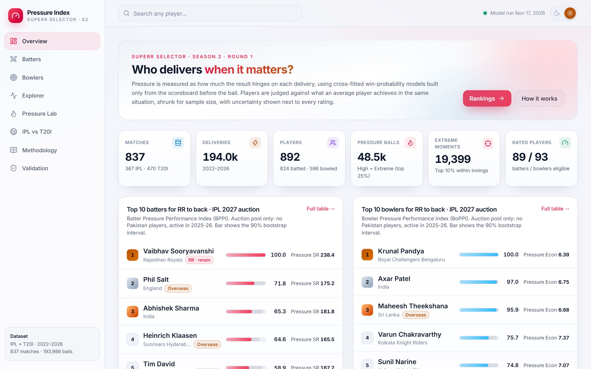
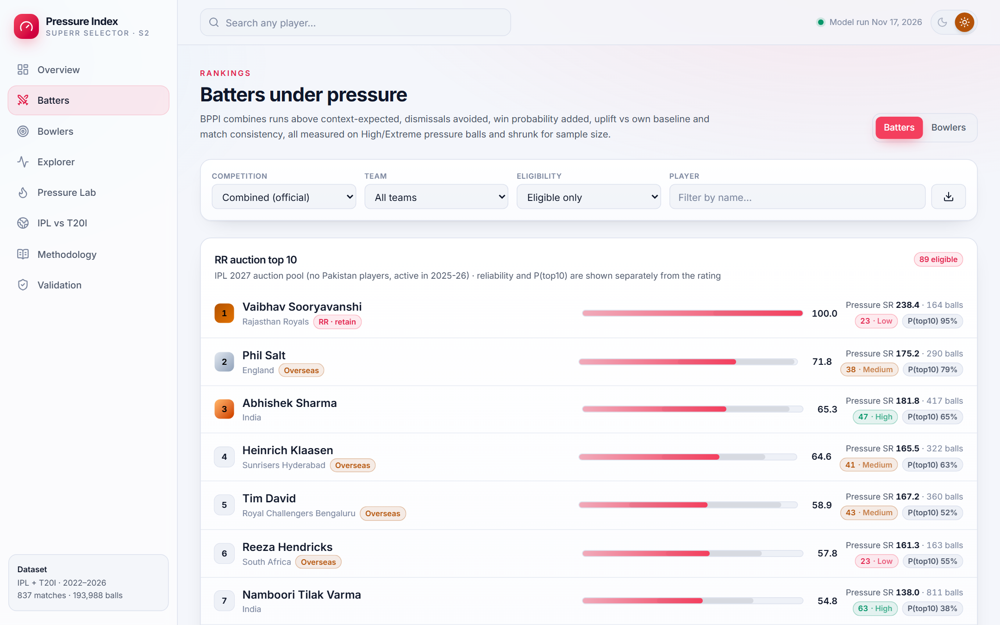
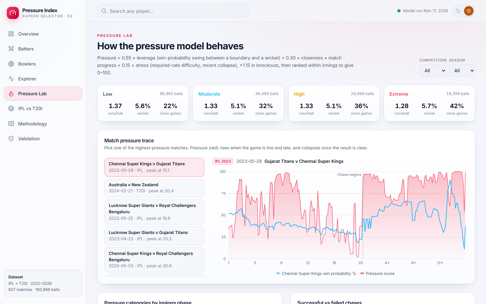

<div align="center">

# Pressure Index

**Who delivers when it matters? Finding the most reliable batters and bowlers under pressure for Rajasthan Royals at the IPL 2027 auction.**

*SupeRR Selector Season 2 · Round 1*

[](https://pressure-index-latest.onrender.com)
[](https://pressure-index-latest.onrender.com/docs)


<a href="https://pressure-index-latest.onrender.com"></a>

**[Open the dashboard](https://pressure-index-latest.onrender.com)** · [Rankings](https://pressure-index-latest.onrender.com/rankings/batters) · [Pressure Lab](https://pressure-index-latest.onrender.com/pressure) · [Methodology](https://pressure-index-latest.onrender.com/methodology) · [Methodology report (PDF)](outputs/methodology_report.pdf)

</div>

> The live site runs on Render's free tier. After a period with no traffic it sleeps, so the first visit can take up to a minute to load.

## Contents

- [Overview](#overview)
- [Results](#results-rr-auction-top-5)
- [Live dashboard](#live-dashboard)
- [Quick start](#quick-start)
- [Command reference](#command-reference)
- [Configuration](#configuration)
- [Outputs](#outputs)
- [API reference](#api-reference)
- [Methodology](#methodology)
- [Glossary](#glossary)
- [Deployment and automation](#deployment-and-automation)
- [Project structure](#project-structure)
- [Limitations](#limitations)
- [Troubleshooting](#troubleshooting)

## Overview

A reproducible analytics system built on IPL and T20I ball-by-ball data (2022 onwards, 837 matches, ~194k deliveries). It does three things:

1. Scores the **pressure on every delivery** (0–100), using win-probability models that only see the scoreboard before the ball.
2. Rates players **only on high-pressure balls**, against what an average player achieves in the same situation, shrunk for sample size and given uncertainty intervals.
3. Ranks the players **Rajasthan Royals can actually buy**. It excludes anyone who has played for Pakistan (they can't play in the IPL) and anyone with no match in 2025–26. Each pick is tagged *retain* or *auction target*, and *Indian* or *overseas*.

```
ball-by-ball CSVs ─► main.py: audit → win-probability models → pressure score → ratings → validation
                                │
                                ├─► outputs/  (top-10 CSVs, all ratings, metrics.json, PDF report)
                                └─► data/processed/analytics.duckdb ─► FastAPI ─► React dashboard
```

## Results: RR auction top 5

| # | Batter | BPPI | Pressure SR | | # | Bowler | BoPPI | Pressure econ |
|---|---|---:|---:|---|---|---|---:|---:|
| 1 | Vaibhav Sooryavanshi *(retain)* | 100.0 | 238.4 | | 1 | Krunal Pandya | 100.0 | 6.39 |
| 2 | Phil Salt | 71.8 | 175.2 | | 2 | Axar Patel | 97.0 | 6.75 |
| 3 | Abhishek Sharma | 65.3 | 181.8 | | 3 | Maheesh Theekshana | 95.9 | 6.68 |
| 4 | Heinrich Klaasen | 64.6 | 165.5 | | 4 | Varun Chakravarthy | 75.7 | 7.37 |
| 5 | Tim David | 58.9 | 167.2 | | 5 | Sunil Narine | 74.8 | 7.07 |

The full top 10s, with intervals, reliability and a written justification for every pick, are in [`outputs/top_10_batters.csv`](outputs/top_10_batters.csv) and [`outputs/top_10_bowlers.csv`](outputs/top_10_bowlers.csv), or live on the [batter](https://pressure-index-latest.onrender.com/rankings/batters) and [bowler](https://pressure-index-latest.onrender.com/rankings/bowlers) rankings.

## Live dashboard

**https://pressure-index-latest.onrender.com**

| Page | Link | What it shows |
|---|---|---|
| Overview | [`/`](https://pressure-index-latest.onrender.com) | Headline numbers and both RR top 10s |
| Rankings | [`/rankings/batters`](https://pressure-index-latest.onrender.com/rankings/batters) · [`/rankings/bowlers`](https://pressure-index-latest.onrender.com/rankings/bowlers) | Full leaderboard, filterable by competition, team and eligibility, with CSV download |
| Player profile | e.g. [`/players/batters/50284`](https://pressure-index-latest.onrender.com/players/batters/50284) | One player's rating components, interval and match-by-match pressure record |
| Explorer | [`/explorer`](https://pressure-index-latest.onrender.com/explorer) | Live aggregates for any filter: season, phase, pressure level, team |
| Pressure Lab | [`/pressure`](https://pressure-index-latest.onrender.com/pressure) | How the pressure score behaves, with ball-by-ball traces of the tensest matches |
| IPL vs T20I | [`/competitions`](https://pressure-index-latest.onrender.com/competitions) | Ratings computed separately per competition |
| Methodology | [`/methodology`](https://pressure-index-latest.onrender.com/methodology) | Data rules, formulas and weights |
| Validation | [`/validation`](https://pressure-index-latest.onrender.com/validation) | Accounting checks, model calibration, sensitivity and stability results |

| Rankings | Pressure Lab |
|---|---|
|  |  |

## Quick start

Requires **Python 3.11+** and **Node 20+**.

```bash
# 1. Python environment
python -m venv .venv
.venv/Scripts/activate            # Windows  (macOS/Linux: source .venv/bin/activate)
pip install -r requirements.txt

# 2. Run the pipeline (about a minute)
python main.py

# 3. Build and serve the dashboard
cd frontend && npm install && npm run build && cd ..
uvicorn backend.main:app --port 8000          # open http://localhost:8000
```

`main.py` reads the CSVs straight from `data/dataset.zip` (if you unzip them into `data/raw/`, those are used instead). It writes everything to `outputs/`, plus `data/processed/*.parquet` and `data/processed/analytics.duckdb`. Seeds are fixed, so every run produces the same results.

## Command reference

| Task | Command |
|---|---|
| Full pipeline + PDF report | `python main.py` |
| Pipeline without the PDF | `python main.py --no-report` |
| Serve API + dashboard | `uvicorn backend.main:app --port 8000` |
| Frontend dev server (hot reload, proxies `/api` to :8000) | `cd frontend && npm run dev` |
| Build the frontend | `cd frontend && npm run build` |
| Python tests (engine, accounting, leakage, outputs, API) | `pytest` |
| Frontend unit tests (Vitest) | `cd frontend && npm test` |
| End-to-end tests (Playwright) | `cd frontend && npm run test:e2e` (needs `npm run build` and `npx playwright install chromium`) |
| Lint the frontend | `cd frontend && npm run lint` |
| Refresh everything from new data | `python scripts/update_pipeline.py` |
| Build / run the Docker image | `docker build -t pressure-index .` · `docker run -p 8000:8000 pressure-index` |

## Configuration

Every modelling choice lives in [`src/config.py`](src/config.py), so the method can be audited and the sensitivity analysis can rerun it with other assumptions.

| Setting | Default | Meaning |
|---|---|---|
| `AUCTION_TEAM` | `"Rajasthan Royals"` | Team the rankings are built for (retain vs auction target) |
| `IPL_INELIGIBLE_NATIONS` | `{"Pakistan"}` | Players who have played for these nations are excluded |
| `AUCTION_MIN_LAST_SEASON` | `2` | Must have played in one of the last N seasons (2025–26) |
| `COMPETITION_WEIGHTS` | IPL 1.0 · T20I Full Member 1.0 · T20I Associate 0.6 | Weight of each delivery when aggregating |
| `PRESSURE_WEIGHTS` | leverage 0.55 · closeness 0.30 · stress 0.15 | Components of the raw pressure score |
| `KNOCKOUT_MULTIPLIER` | `1.15` | Pressure boost in knockout matches |
| `PRESSURE_THRESHOLD` | `75` | Score at or above which a ball counts as a pressure ball |
| `PRESSURE_BINS` / `PRESSURE_LABELS` | 0 / 50 / 75 / 90 | Low · Moderate · High · Extreme |
| `MIN_PRESSURE_BALLS_BAT` / `_BOWL` | `150` | Minimum pressure balls to be ranked |
| `MIN_PRESSURE_MATCHES` | `15` | Minimum matches with pressure balls to be ranked |
| `BPPI_WEIGHTS` | scoring .30 · survival .20 · impact .20 · uplift .15 · consistency .15 | Batter rating weights |
| `BOPPI_WEIGHTS` | economy .30 · wickets .20 · impact .20 · uplift .15 · consistency .15 | Bowler rating weights |
| `BOOTSTRAP_REPS` | `300` | Match-level bootstrap resamples for intervals |
| `SEED` | `42` | Random seed (results are deterministic) |

## Outputs

| File | Contents |
|---|---|
| [`outputs/top_10_batters.csv`](outputs/top_10_batters.csv) | RR auction top 10 batters |
| [`outputs/top_10_bowlers.csv`](outputs/top_10_bowlers.csv) | RR auction top 10 bowlers |
| [`outputs/complete_player_ratings.csv`](outputs/complete_player_ratings.csv) | Every rated batter and bowler, including IPL-only and T20I-only ratings and exclusion reasons |
| `outputs/pressure_delivery_analysis.csv` | Pressure score and context for every delivery (generated locally; over 100 MB, so not committed) |
| [`outputs/methodology_report.pdf`](outputs/methodology_report.pdf) | 17-section methodology and validation report |
| [`outputs/metrics.json`](outputs/metrics.json) | Data audit, accounting checks, model AUCs, sensitivity and stability results |
| [`outputs/figures/`](outputs/figures/) | Charts used in the report |
| `data/processed/analytics.duckdb` | Database the API reads (deliveries, ratings, player-match tables) |

**Key columns in the top-10 files**

| Column | Meaning |
|---|---|
| `rank`, `name`, `player_id` | Position in the RR auction ranking |
| `auction_status` | Current RR player to retain, or auction target |
| `player_type`, `nationality`, `last_ipl_team` | Indian / overseas, country, most recent IPL team |
| `BPPI` / `BoPPI`, `…_lo`, `…_hi` | Rating (0–100) and its 90% bootstrap interval |
| `p_balls` / `p_legal_balls` | Pressure balls faced / bowled |
| `p_sr`, `n_sr` (batters) | Strike rate on pressure balls vs normal balls |
| `p_econ`, `n_econ` (bowlers) | Economy on pressure balls vs normal balls |
| `reliability` | 0–100 confidence in the rating, reported separately from it |
| `p_top10`, `rank_lo`, `rank_hi` | Probability of being top 10, and the plausible rank range |
| `justification` | One-line plain-English reason for the pick |

## API reference

Base URL: **https://pressure-index-latest.onrender.com** (or `http://localhost:8000` locally). Interactive docs: [`/docs`](https://pressure-index-latest.onrender.com/docs). `{role}` is `batters` or `bowlers`.

| Endpoint | Parameters | Returns |
|---|---|---|
| [`GET /api/health`](https://pressure-index-latest.onrender.com/api/health) | none | Service status |
| [`GET /api/overview`](https://pressure-index-latest.onrender.com/api/overview) | none | Headline counts (matches, deliveries, players, pressure balls) |
| [`GET /api/top10/{role}`](https://pressure-index-latest.onrender.com/api/top10/batters) | none | RR auction top 10 |
| [`GET /api/rankings/{role}`](https://pressure-index-latest.onrender.com/api/rankings/bowlers) | `competition`, `team`, `search`, `eligible_only`, `limit` | Full leaderboard |
| `GET /api/players/{role}/{player_id}` | `competition`, `season` | Player profile and rating components |
| `GET /api/players/{role}/{player_id}/distribution` | none | Bootstrap distribution of the rating |
| [`GET /api/search`](https://pressure-index-latest.onrender.com/api/search?q=salt) | `q`, `limit` | Player name search |
| `GET /api/explorer/{role}` | `competition`, `season`, `team`, `pressure_category`, `phase`, `min_balls`, `limit` | Live aggregates for any filter |
| [`GET /api/pressure/summary`](https://pressure-index-latest.onrender.com/api/pressure/summary) | `competition`, `season` | Outcomes by pressure category and phase |
| [`GET /api/pressure/moments`](https://pressure-index-latest.onrender.com/api/pressure/moments) | `competition`, `season`, `limit` | Highest-pressure matches |
| `GET /api/matches/{match_id}` | none | Ball-by-ball pressure and win-probability trace |
| `GET /api/competition/{role}` | none | IPL vs T20I ratings side by side |
| [`GET /api/filters`](https://pressure-index-latest.onrender.com/api/filters) | none | Available competitions, seasons and teams |
| [`GET /api/methodology`](https://pressure-index-latest.onrender.com/api/methodology) | none | Config and data-audit facts |
| [`GET /api/validation`](https://pressure-index-latest.onrender.com/api/validation) | none | Validation metrics |

```bash
curl "https://pressure-index-latest.onrender.com/api/top10/batters"
curl "https://pressure-index-latest.onrender.com/api/rankings/bowlers?competition=IPL&limit=20"
```

## Methodology

The full write-up is in the [methodology report](outputs/methodology_report.pdf) and on the [Methodology page](https://pressure-index-latest.onrender.com/methodology).

**1. Data audit.** The audit established these rules before any modelling:
- `extras1_runs` holds the extra runs on each ball (e.g. 5 wides = 5, penalty = 5); `extras_2_runs` holds byes run off a no-ball.
- `other` extras behave as no-balls.
- Using the recorded amounts, the rebuilt innings totals reproduce the official winning margin exactly in 99.7% of matches (all within 3 runs).
- Super overs and the two A-team events are excluded.
- All joins use player IDs.

**2. Win probability.** Monotone-constrained gradient-boosted models estimate P(win) from the scoreboard before each ball:
- Chase model inputs: runs needed, balls left, wickets in hand, required rate.
- First-innings model inputs: runs, balls left, wickets in hand.
- Both are cross-fitted by match, so no match's result informs its own predictions (no leakage).
- Out-of-fold AUC: 0.69 for the first innings, 0.89 for chases.

**3. Pressure score (0–100).**

```
R = 0.55·leverage + 0.30·closeness×match_progress + 0.15·stress   (×1.15 in knockouts)
leverage = WP(if four) − WP(if wicket)
Pressure = within-innings percentile of R
```

- Categories: Low below 50, Moderate 50–75, High 75–90, Extreme 90 and above. High + Extreme together are "pressure" balls.
- Final overs in decided games are almost never classed as pressure (0.4%).

**4. Ratings.** Players are rated only on pressure balls, against a context-expected outcome (same competition, innings, over, wickets, pressure level and opposition).
- **BPPI (batters):** scoring 30%, survival 20%, win probability added 20%, uplift over own baseline 15%, match consistency 15%.
- **BoPPI (bowlers):** runs saved 30%, wickets 20%, WPA 20%, uplift 15%, consistency 15%.
- Every component is empirical-Bayes shrunk, so noisy components carry less weight automatically.

**5. Fairness and reliability.**
- Eligibility: at least 150 pressure balls across at least 15 matches, and in the IPL 2027 auction pool (not Pakistan, active in 2025–26).
- T20Is against Associate sides are weighted 0.6.
- Each rating comes with a 90% match-level bootstrap interval, a rank range and P(top-10).
- A reliability score (0–100) is reported separately from the rating, never mixed into it.

**6. Validation.** The pipeline checks itself:
- Accounting and leakage checks.
- A manual recount of the #1 players' numbers.
- 13 sensitivity scenarios.
- Split-half (era) stability.
- A 2025–26 hold-out test of the win-probability models.

## Glossary

| Term | Meaning |
|---|---|
| **Pressure score** | 0–100 rank of how much the match result hinges on a delivery, within its innings |
| **Pressure ball** | A delivery with a pressure score of 75 or more (High or Extreme) |
| **WP** | Win probability of the batting side before the ball |
| **Leverage** | How far WP swings between a four and a wicket on this ball |
| **WPA** | Win probability added: the change in WP caused by the ball's actual outcome |
| **BPPI** | Batter Pressure Performance Index (0–100) |
| **BoPPI** | Bowler Pressure Performance Index (0–100) |
| **Uplift** | Performance on pressure balls compared with the player's own normal-ball baseline |
| **Shrinkage** | Pulling small-sample ratings towards the average, so a lucky short run doesn't top the table |
| **Reliability** | How much to trust a rating, given sample size and interval width |
| **P(top10)** | Share of bootstrap resamples in which the player ranks in the top 10 |

## Deployment and automation

**Docker.** The image builds the React frontend and serves it from FastAPI, using the committed `analytics.duckdb` and `metrics.json`. The pipeline does not run inside the image.

```bash
docker build -t pressure-index .
docker run -p 8000:8000 pressure-index        # open http://localhost:8000
```

A prebuilt image is on Docker Hub: `docker pull kunnal404/pressure-index:latest`.

**Render.** [`render.yaml`](render.yaml) deploys the Dockerfile as a web service, with `/api/health` as the health check. The live instance is at **https://pressure-index-latest.onrender.com**.

**Nightly auto-update.** [`scripts/update_pipeline.py`](scripts/update_pipeline.py) refreshes everything when new data arrives. Drop updated CSVs into `local/dataset/` and the script:

1. Detects which CSVs changed, copies them into `data/raw/` and rebuilds `data/dataset.zip`. No change means no run.
2. Reruns `main.py`, then `pytest`. If the tests fail, nothing is published.
3. Rebuilds the frontend, then builds and pushes the Docker image.
4. Commits the refreshed outputs, and pushes them if a git remote is set.

```powershell
powershell -ExecutionPolicy Bypass -File scripts\register_schedule.ps1    # schedule daily at 00:05 (Windows)
python scripts/update_pipeline.py --force --no-publish                    # manual run, no Docker/git
```

Logs are written to `local/logs/`.

## Project structure

```
├── main.py                 one-command pipeline
├── src/                    analytics engine
│   ├── data_loader.py        load + audit the raw CSVs
│   ├── preprocessing.py      delivery accounting, leakage-free match state
│   ├── pressure_model.py     win-probability models + pressure score
│   ├── expected.py           context-expected outcomes
│   ├── rating_engine.py      shrinkage, bootstrap intervals
│   ├── batter_ratings.py     BPPI
│   ├── bowler_ratings.py     BoPPI
│   ├── reliability.py        reliability score
│   ├── auction.py            IPL 2027 auction-pool rules
│   ├── rankings.py           final tables, competition splits
│   ├── validation.py         accounting, stability, sensitivity checks
│   ├── report.py             methodology PDF
│   └── config.py             every tunable assumption
├── backend/                FastAPI app (main.py, db.py, schemas.py)
├── frontend/               React dashboard (src/pages, src/components, e2e/)
├── tests/                  pytest suite
├── scripts/                nightly auto-update + Windows scheduler setup
├── data/
│   ├── dataset.zip           supplied CSVs (read directly by the pipeline)
│   └── processed/            parquet + DuckDB (generated)
├── outputs/                final CSVs, metrics.json, figures/, methodology_report.pdf
├── docs/screenshots/       README images
├── Dockerfile · render.yaml  deployment
└── requirements.txt        pipeline deps (requirements-api.txt: API image only)
```

## Limitations

See section 16 of the [methodology report](outputs/methodology_report.pdf) for the full list.

- Batting-first pressure is inherently harder to read (AUC 0.69).
- "Clutch" uplift and pressure wicket-taking repeat only weakly at these sample sizes.
- Year-to-year stability is modest, so read ranks 8–15 as a band.
- The win-probability models see only the scoreboard, not venue, pitch, dew or team strength.

## Troubleshooting

| Problem | Fix |
|---|---|
| The live site takes a long time to open | It is waking up from Render's free-tier sleep; wait up to a minute |
| `http://localhost:8000` shows only the API, no dashboard | Build the frontend first: `cd frontend && npm run build` |
| The API reports missing tables | Run `python main.py` to create `data/processed/analytics.duckdb` |
| `FileNotFoundError` for `dataset.zip` | Put the CSVs in `data/raw/` or restore `data/dataset.zip` |
| DuckDB version error in Docker | `duckdb` in `requirements-api.txt` must match the version that wrote the database |
| The nightly job skipped the Docker step | Docker Desktop wasn't running; check `local/logs/` |

## Built with AI-assisted tools

AI-assisted development tools helped build this project:

- **Claude Code** (Anthropic): coding, the data pipeline, debugging, testing and documentation
- **Google Antigravity**: agent-assisted development
- **Visual Studio Code**: the main editor and development environment

The analysis, modelling choices and final rankings were reviewed and directed throughout the project.
